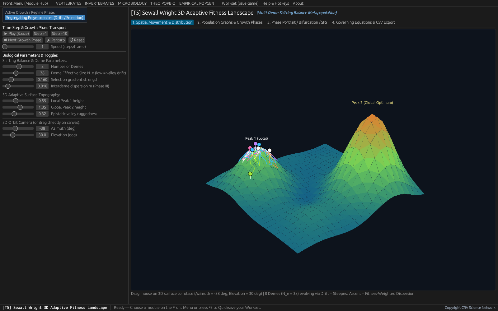

# PopBio Studio (`popbio-studio` v1.2.0)



**PopBio Studio (`v1.2.0`)** is a zero-unsafe (`#![forbid(unsafe_code)]` library, `#![deny(unsafe_code)]` binary outside Windows console attach), native safe-Rust **19-module population biology, theoretical evolutionary genetics, Bayesian Skyline, and haplotype network workstation** (`eframe` / `egui` `0.31`) paired with a headless FASTA/ODE CLI (`clap`), built-in scientific plotting engine, and bundled SQLite WAL worksets (`rusqlite`).

- **License**: GNU General Public License v3.0 or later (`GPL-3.0-or-later`)
- **Zenodo DOI**: [`10.5281/zenodo.24244085`](https://doi.org/10.5281/zenodo.24244085) (`APP-PREPRINT-15`)
- **Web Hub**: [https://crvscience.com/apps](https://crvscience.com/apps)

## Highlights Across the 4 Upgrade Pillars

1. **Usability & Keyboard-First Controls**:
   - Keyboard hotkeys guarded by `!ctx.wants_keyboard_input()`: `1`–`4` switch workspace tabs (`V1..T6`) or empirical modules (`E1..E4`), `Space` plays/pauses, `.` advances a single simulation step, `N` steps into the next biological growth phase, `R` resets the active module, `F1` toggles Help/Shortcuts, `F5`/`F9` quicksave/quickload SQLite slots, and `Esc` closes modals before returning to the Front Menu.
   - Detailed `.on_hover_text(...)` equations, physical units, and bifurcation threshold tooltips across parameter controls (`V1..T6` and `E1..E4`); ASCII-safe UI button labels without tofu-risk Unicode glyphs; mouse scroll-wheel zoom + one-click **Reset 3D View** on the Sewall Wright 3D landscape (`T5`); and scenario presets on dynamical/theoretical modules (`V1`, `V3`, `I1`, `T1`, `T2`, `T3`, `T5`, `T6`).
2. **Scientific & Statistical Rigor**:
   - **Harpending's Mismatch Raggedness (`E1`, `E3`)**: Fixed mismatch index off-by-one (`r = sum_{i=1}^{d_max+1} (x_i - x_{i-1})^2`) so `n` identical sequences cleanly yield exact `r = 1.0`.
   - **Fu & Li's `D*` and `F*` (`E1`, `E4`)**: Uses exact multi-allelic total mutations `eta = sum_site (alleles - 1)`, per-allele singleton count `eta_1`, and complete Simonsen, Churchill & Aquadro (1995) unrooted `F*` variance (`a_theta = (n+1)/(3(n-1)) + (n-5)/n`, `b_theta^2 = ((n-1)/n)^2 d_n + 2(n^2+n+3)/(9n(n-1)) - 2(4 a_1 + 2 - n)/n^2`).
   - **Bayesian Skyline MCMC (`E3`)**: Rejects out-of-bounds `[1e-8, 50.0]` scale proposals in-place without clamping bias while keeping exact `+delta` log-normal Jacobian, applies exact adjacent-boundary Hastings ratio `ln(N_valid(cur) / N_valid(next))`, and excludes skipped dead-end moves from `proposals`.
3. **2D / 3D Canvas & Plot Fidelity**:
   - **Sewall Wright 3D Adaptive Landscape (`T5`)**: Face-normal Lambertian diffuse + Blinn-Phong specular surface relief shading, projected 3D `Trait X` / `Trait Y` / `W_bar` axes with numeric ticks, and a dedicated vertical `W_bar` fitness colorbar (`0.45..1.60`).
   - **Spatial Patch Hover Telemetry (`I2`, `M3`, `T1`)**: Live mouse-hover highlight and per-patch quantitative popups across Huffaker 6x4 citrus oranges, 24x24 bacteriophage agar cells, and 64-patch Levins metapopulation nodes.
   - **Scientific Plotting Engine**: Adaptive scientific tick formatter (`5.00e-4` for nucleotide diversity `pi`, `1.00e6` for large `N_e`), explicit X/Y axis titles, interactive **Log-Y** toggle across time-series plots and `E3` Skyline `N_e(t)`, plus live crosshair coordinate readout.

## Controls & Hotkeys

| Input | Action | Notes |
| --- | --- | --- |
| `1` – `4` | Switch workspace tab / empirical view | Switches Tabs `1..4` (`V1..T6`) or `E1..E4` (`E1..E4`) |
| `Space` | Play / Pause simulation | Supports both dynamical models and `E2` haplotype drift |
| `.` (Period) | Single simulation step | Steps active ODE/discrete/lattice module or `E2` generation |
| `N` | Next growth phase | Advances until phase transitions (e.g., Lag -> Log -> Diauxic) |
| `R` | Reset active module | Restores baseline empirical parameters |
| `F1` | Toggle Shortcuts & Citations modal | — |
| `F5` / `F9` | Quicksave / Quickload SQLite slot | Uses `popbio_worksets.sqlite3` slot `"Quicksave"` |
| `Esc` | Dismiss modal / Return to Front Menu | Closes About -> Help before leaving workspace |
| 3D Drag / Wheel | Orbit / Zoom Wright 3D landscape (`T5`) | Zoom `0.55x..2.40x`; **Reset 3D View** restores defaults |
| Patch / Plot Hover | Inspect patch or `(x, y)` coordinates | Works on `I2`, `M3`, `T1` arenas and all scientific plots |

## CLI Reference

| Command / Flag | Description | Default |
| --- | --- | --- |
| `--module <SLUG>` | Jump directly to module (e.g., `v1-hare-lynx`, `e3-bayesian-skyline`, `e4-sliding-window`) | Front Menu |
| `--load-workset <JSON>` | Restore portable `.popworkset.json` Workset at startup | Off |
| `--headless-screenshot <PNG>` | Render 1600x1000 offscreen GPU PNG screenshot and exit | Off |
| `--screenshot-view <1..3>` | Headless preset (`1` Wright 3D, `2` Skyline, `3` Haplotype Network) | `1` |
| `simulate [--module <SLUG>] [--steps 400] [--out simulation_output.csv]` | Run headless dynamical module & export time series + phases to CSV | — |
| `analyze-fasta <INPUT> [options]` | Empirical FASTA/PHYLIP/NEXUS PopGen, Skyline MCMC, sliding windows, network | — |

Key `analyze-fasta` flags: `--epsilon 0`, `--bsp-groups 4`, `--bsp-mcmc-steps 2500`, `--clock-rate 1e-7`, `--window-bp 24`, `--step-bp 6`, `--out-stats <JSON>`, `--out-skyline-csv <CSV>`, `--out-windows-csv <CSV>`, `--out-svg <SVG>`, `--out-gexf <GEXF>`.

## Build & Validation

```powershell
$env:CARGO_BUILD_JOBS='4'; cargo test --all-targets
cargo run --release
```

Observed `--all-targets` verification (`cargo test --all-targets`):
- `src\lib.rs`: `16 passed; 0 failed` (zero warnings)
- `src\main.rs`: `1 passed; 0 failed`
- `tests\popbio_integration.rs`: `12 passed; 0 failed` (verifies identical-sequence Harpending `r == 1.0`, tri-allelic `{A:6, C:1, G:1}` `eta == 2, singleton_sites_eta1 == 2` with exact Simonsen/Fu & Li `D*`/`F*`, BSP MCMC bounds rejection & boundary Hastings ratio, adaptive scientific tick formatting, hotkeys `1`–`4`/`R`/`.`/`N`, and all 19 modules stepping & exporting cleanly).

## Documentation

- [User Guide](docs/USER_GUIDE.md)
- [Scientific & Coalescent Methods](docs/SCIENTIFIC_METHODS.md)
- **Illustrated PDF Guide**: `docs/PopBio_Studio_v1_2_0_Guide.pdf`
- **Example Alignments & Circuits**: `examples/*.fasta`
